# 潛水艇碼頭隨機事件預覽

所有圖片均由 Playwright 驅動 Chromium 實際渲染新版碼頭，再以開發預覽模式（`?harbor-dev=1`）指定事件、跳到關鍵影格後截取。圖上標示事件編號、名稱、時段條件、關鍵影格與時間點。

- 全景：[白天](panorama/00-panorama-day.png)｜[黃昏](panorama/00-panorama-dusk.png)｜[夜晚](panorama/00-panorama-night.png)｜[清晨](panorama/00-panorama-dawn.png)｜手機：[白天](panorama/00-panorama-day-m.png)、[黃昏](panorama/00-panorama-dusk-m.png)、[夜晚](panorama/00-panorama-night-m.png)、[清晨](panorama/00-panorama-dawn-m.png)
- 動畫 GIF：[cat](gif/cat.gif)、[chocobo](gif/chocobo.gif)、[seal](gif/seal.gif)、[supply](gif/supply.gif)、[teleport](gif/teleport.gif)、[whale](gif/whale.gif)
- 也可以開啟 `index.html` 以網格檢視。

### 開發預覽模式

在網址加上 `?harbor-dev=1` 後，右上角會出現開發用控制面板，可以：
- 指定並播放任一事件
- 暫停、繼續、重播、重置
- 切換白天、黃昏、夜晚、清晨
- 開關自動隨機排程
- 查看目前播放的事件與進度

Playwright 也可以透過 `window.HarborScene.events` 控制事件：`play(id,{seed})`、`seek(秒)`、`freeze(true)`、`setHour(h)`、`status()`。

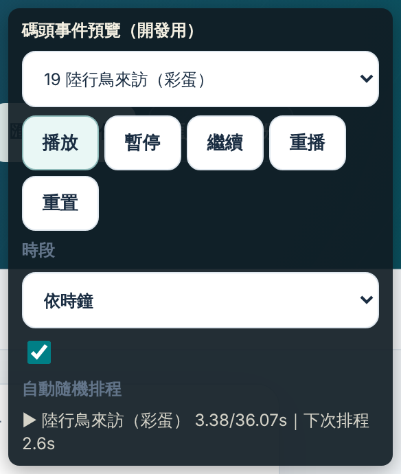

正常網址不會顯示控制面板，也不會提供播放控制，只能查詢事件清單與狀態（`list()`／`status()`）。

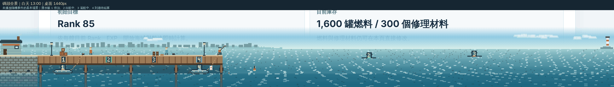
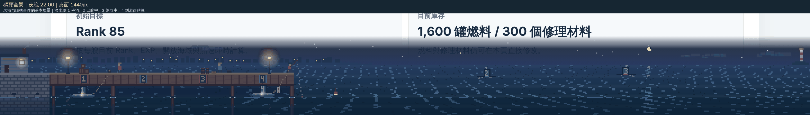

## 事件一覽

| # | 事件 | 時段條件 | 內容 |
|---|---|---|---|
| 01 | [海豹探頭](#e01) | 不限時段 | 海面先出現漣漪，海豹探出頭和肩膀，左右張望、眨眼並望向棧橋，接著翻身潛下並濺起水花。 |
| 02 | [小魚群](#e02) | 不限時段 | 魚群在水面下成群游過，上方泛起細小波紋；途中一條魚躍出水面，劃出弧線後落水濺起水花。 |
| 03 | [石縫螃蟹](#e03) | 不限時段 | 螃蟹先從堤岸石縫露出眼睛，接著橫著爬出來，途中兩度停下舉起大螯，最後鑽進另一道石縫。 |
| 04 | [夜光水母](#e04) | 僅限夜晚 | 僅限夜晚。兩到三隻水母在水中緩緩上浮，傘狀身體一張一縮，觸手隨水擺動並發出柔和光芒。 |
| 05 | [海鷗歇腳](#e05) | 白天至黃昏 | 海鷗從外海滑翔而來，展翼減速後停在繫纜樁上，理毛、抖羽、轉頭張望，休息片刻後再起飛離開。 |
| 06 | [長尾山雀](#e06) | 白天至黃昏 | 僅限白天。長尾山雀以起伏的飛行軌跡飛到路燈頂端，在燈罩上跳動、歪頭、甩尾，接著飛走。 |
| 07 | [冒險者看海](#e07) | 不限時段 | 冒險者（貓魅族等三種造型）從岸邊走上棧橋，坐下欣賞海景並哼歌，起身後手搭眉梢遠眺，再原路離開；夜晚會提著燈籠。 |
| 08 | [傳送魔法](#e08) | 不限時段 | 地面亮起以太光環，光柱升起，旅人由上而下顯形；四處張望、冒出問號後施法，從腳下開始化為光粒子離去。 |
| 09 | [潛水艇檢修](#e09) | 不限時段 | 需有停泊中的潛水艇。指揮塔艙蓋打開，維修員爬出來走到艇艏，蹲下焊接並冒出火花，完成後揮手，再爬回艙內關上艙蓋。 |
| 10 | [碼頭小貓](#e10) | 不限時段 | 小貓從貨箱後走出來，坐下理毛、伸懶腰；白天會撲蝴蝶，之後蜷起來打盹並冒出 z。有人經過時會抬頭，夜晚眼睛會反光。 |
| 11 | [遠方帆船](#e11) | 不限時段 | 遠方的小帆船沿著水平線緩緩駛過，船後拖著細細的航跡；夜晚船上會亮起燈火。 |
| 12 | [補給物資](#e12) | 不限時段 | 需有停泊中的潛水艇。搬運工從港務所推出補給推車，停在潛水艇上方，打開艇艏甲板艙門，用繩索把兩箱物資依序吊進艙內，再推車返回。 |
| 13 | [壓載艙測試](#e13) | 不限時段 | 需有停泊中的潛水艇。艇身周圍冒出氣泡，接著一陣排氣，水面出現漣漪和細小水花。 |
| 14 | [流星](#e14) | 僅限夜晚 | 僅限夜晚。一顆流星劃過天空並留下漸淡的尾跡；偶爾會出現四到六顆的小型流星雨。 |
| 15 | [漂流瓶](#e15) | 不限時段 | 漂流瓶從遠方海面朝棧橋漂近，越靠近看起來越大；瓶身隨浪搖擺並閃光，周圍泛起漣漪。 |
| 16 | [一陣強風](#e16) | 不限時段 | 一陣強風吹過：天空出現風痕，樹葉（夜晚為紙片）沿棧橋翻滾，海面泛起白浪；雲、煙和旗幟也會同時被吹動。 |
| 17 | [碼頭偶遇](#e17) | 不限時段 | 港務人員在棧橋上眺望大海，訪客從港務所走出來，兩人打招呼（!、♪／♥）後各自離開。 |
| 18 | [鯨魚現身（彩蛋）](#e18) | 不限時段 | 稀有彩蛋。遠方海面湧起，鯨魚露出背脊並噴氣，翻身下潛後揚起尾鰭，最後落水濺起水花。 |
| 19 | [陸行鳥來訪（彩蛋）](#e19) | 不限時段 | 稀有彩蛋。陸行鳥沿棧橋小跑過來，停下「Kweh!」一聲並拍動小翅膀，張望海面後跑回去。 |

## 01. 海豹探頭

海面先出現漣漪，海豹探出頭和肩膀，左右張望、眨眼並望向棧橋，接著翻身潛下並濺起水花。

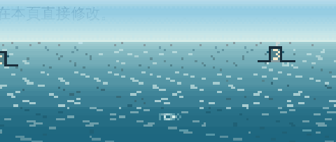

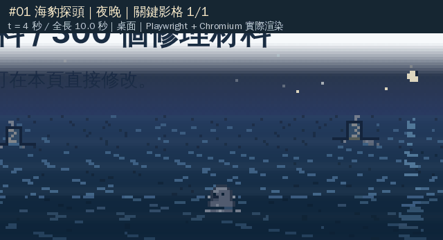
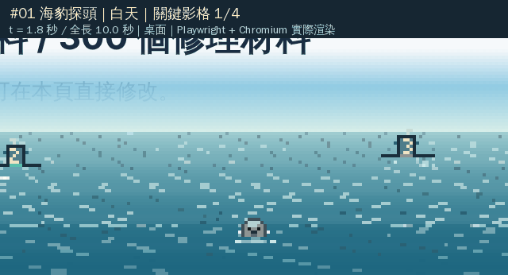
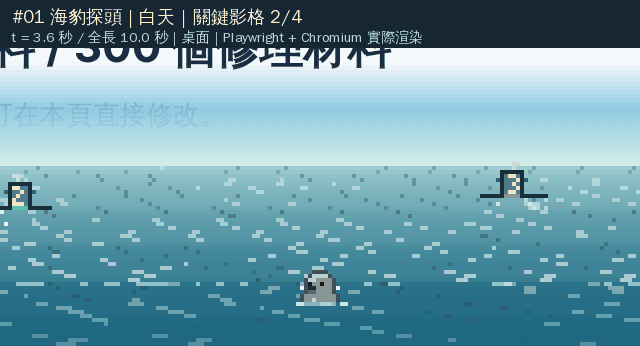
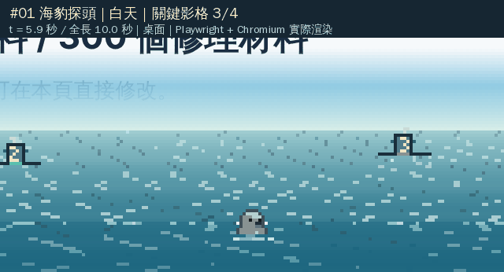
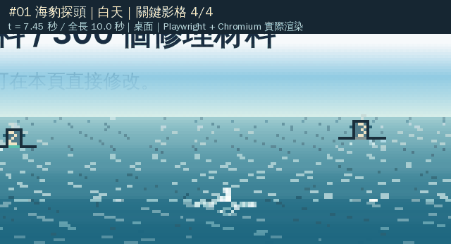
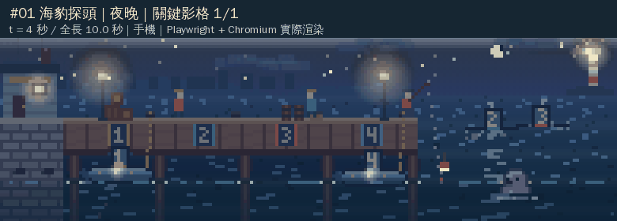
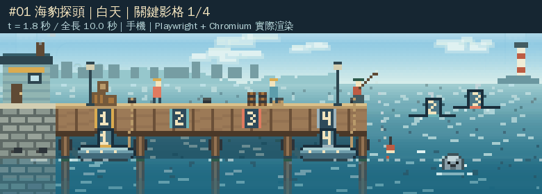

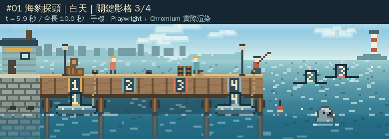
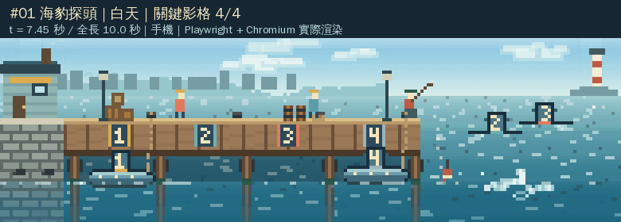

## 02. 小魚群

魚群在水面下成群游過，上方泛起細小波紋；途中一條魚躍出水面，劃出弧線後落水濺起水花。

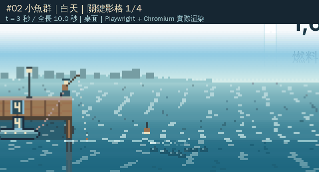
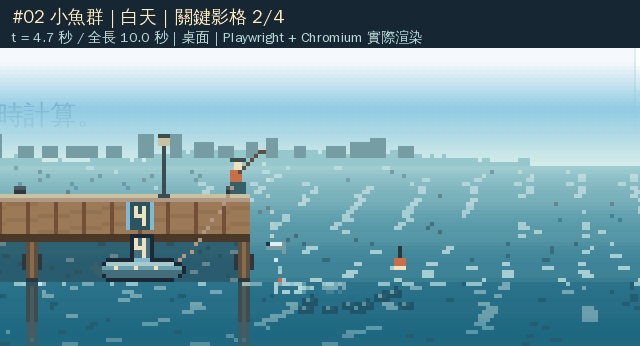
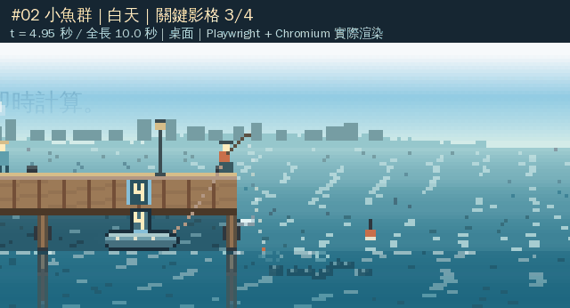
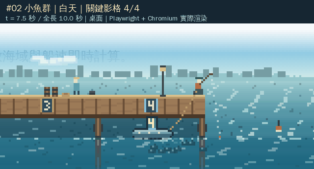

## 03. 石縫螃蟹

螃蟹先從堤岸石縫露出眼睛，接著橫著爬出來，途中兩度停下舉起大螯，最後鑽進另一道石縫。

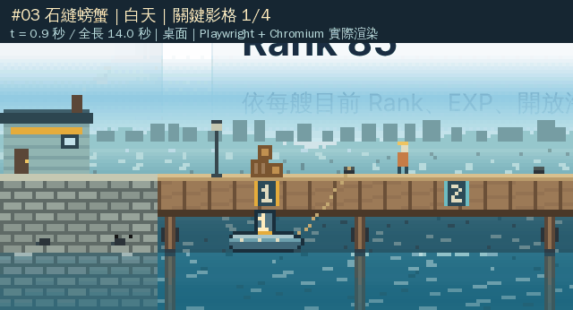
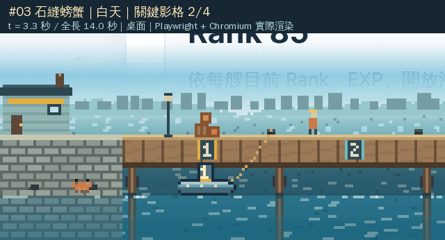

## 04. 夜光水母

僅限夜晚。兩到三隻水母在水中緩緩上浮，傘狀身體一張一縮，觸手隨水擺動並發出柔和光芒。

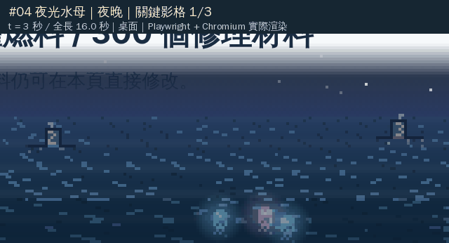
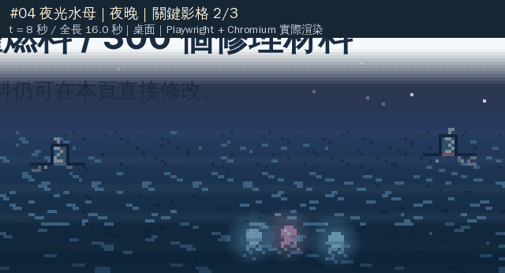
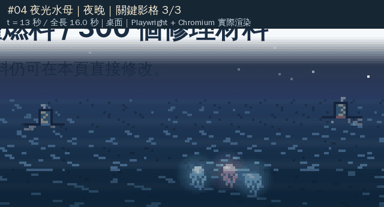
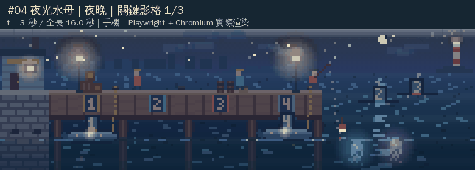

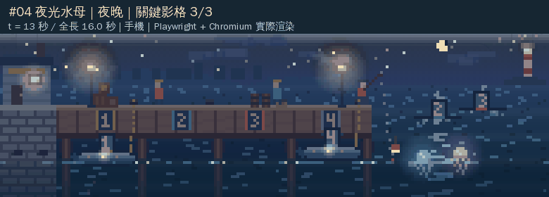

## 05. 海鷗歇腳

海鷗從外海滑翔而來，展翼減速後停在繫纜樁上，理毛、抖羽、轉頭張望，休息片刻後再起飛離開。

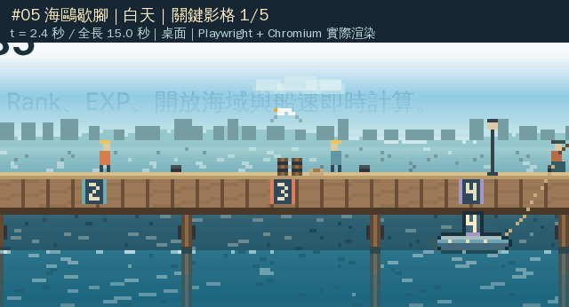
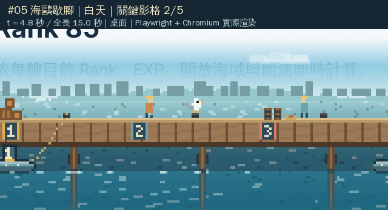
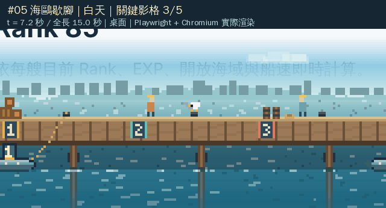
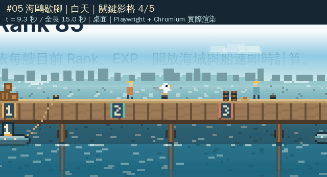
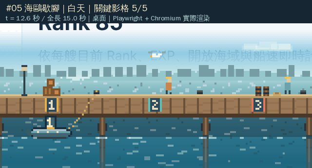

## 06. 長尾山雀

僅限白天。長尾山雀以起伏的飛行軌跡飛到路燈頂端，在燈罩上跳動、歪頭、甩尾，接著飛走。

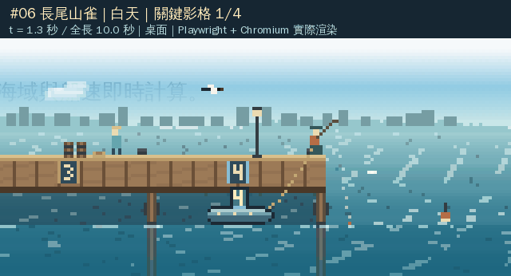
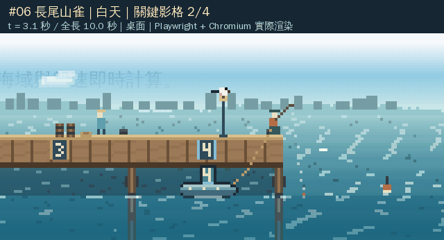

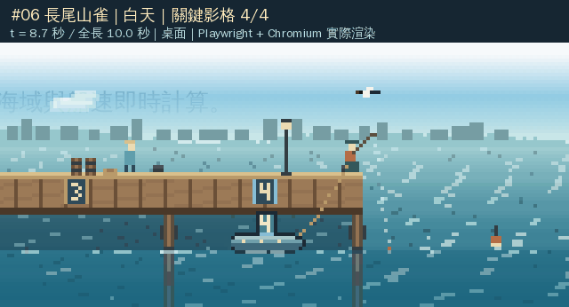

## 07. 冒險者看海

冒險者（貓魅族等三種造型）從岸邊走上棧橋，坐下欣賞海景並哼歌，起身後手搭眉梢遠眺，再原路離開；夜晚會提著燈籠。

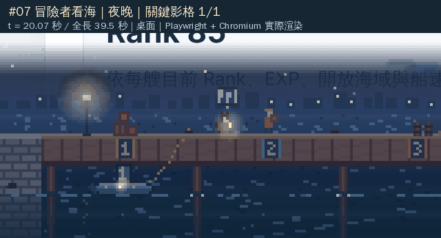

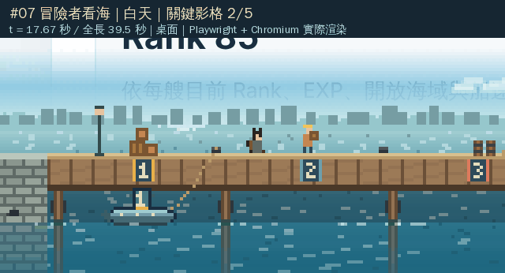
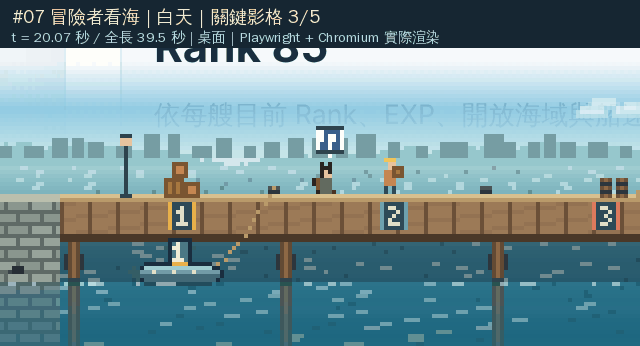
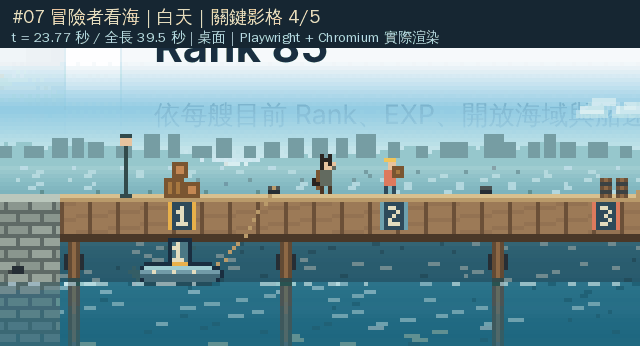
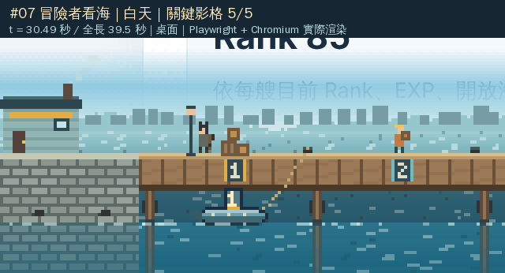

## 08. 傳送魔法

地面亮起以太光環，光柱升起，旅人由上而下顯形；四處張望、冒出問號後施法，從腳下開始化為光粒子離去。

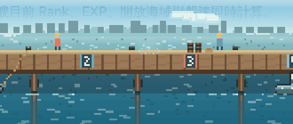

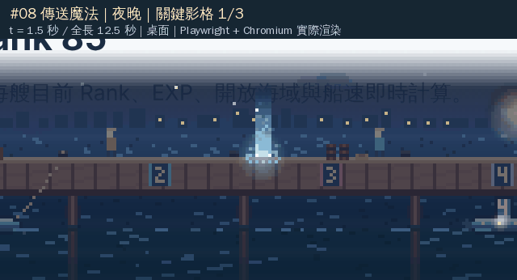
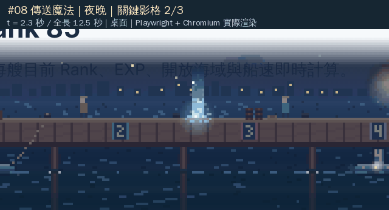
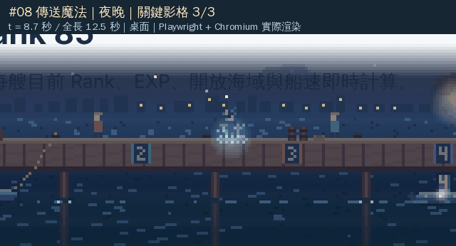
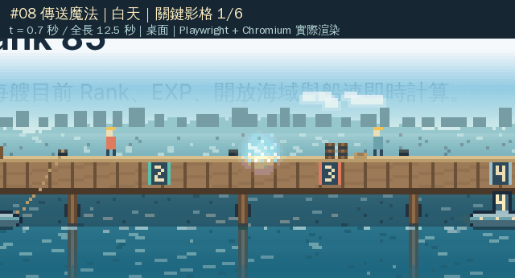
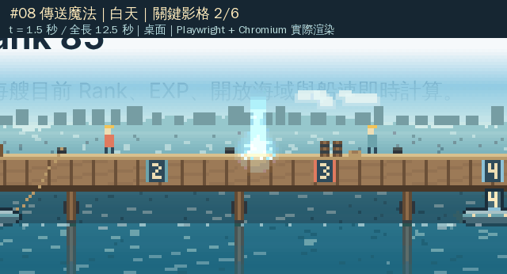
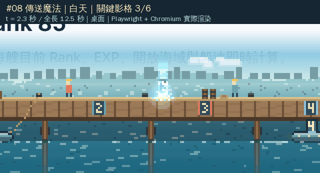
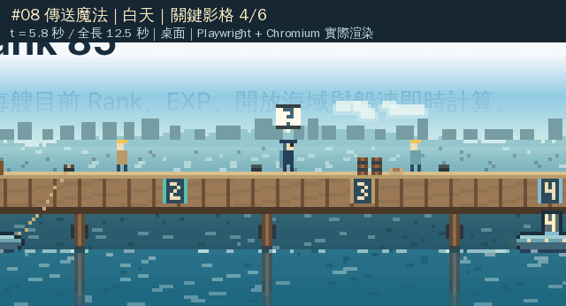
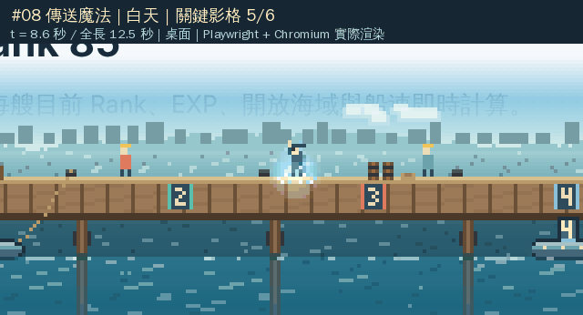
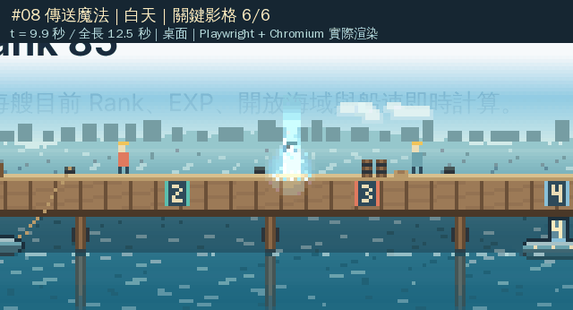
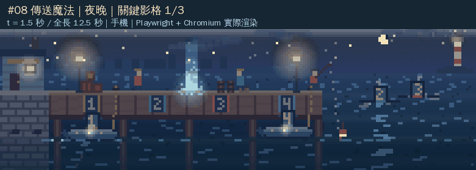
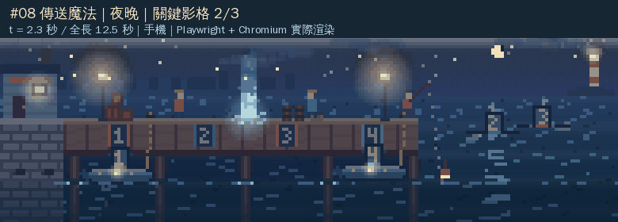
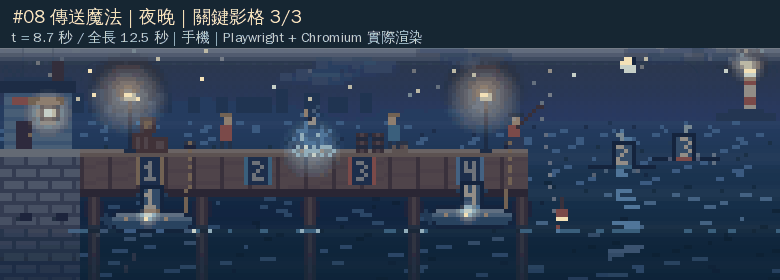

## 09. 潛水艇檢修

需有停泊中的潛水艇。指揮塔艙蓋打開，維修員爬出來走到艇艏，蹲下焊接並冒出火花，完成後揮手，再爬回艙內關上艙蓋。

## 10. 碼頭小貓

小貓從貨箱後走出來，坐下理毛、伸懶腰；白天會撲蝴蝶，之後蜷起來打盹並冒出 z。有人經過時會抬頭，夜晚眼睛會反光。

## 11. 遠方帆船

遠方的小帆船沿著水平線緩緩駛過，船後拖著細細的航跡；夜晚船上會亮起燈火。

## 12. 補給物資

需有停泊中的潛水艇。搬運工從港務所推出補給推車，停在潛水艇上方，打開艇艏甲板艙門，用繩索把兩箱物資依序吊進艙內，再推車返回。

## 13. 壓載艙測試

需有停泊中的潛水艇。艇身周圍冒出氣泡，接著一陣排氣，水面出現漣漪和細小水花。

## 14. 流星

僅限夜晚。一顆流星劃過天空並留下漸淡的尾跡；偶爾會出現四到六顆的小型流星雨。

## 15. 漂流瓶

漂流瓶從遠方海面朝棧橋漂近，越靠近看起來越大；瓶身隨浪搖擺並閃光，周圍泛起漣漪。

## 16. 一陣強風

一陣強風吹過：天空出現風痕，樹葉（夜晚為紙片）沿棧橋翻滾，海面泛起白浪；雲、煙和旗幟也會同時被吹動。

## 17. 碼頭偶遇

港務人員在棧橋上眺望大海，訪客從港務所走出來，兩人打招呼（!、♪／♥）後各自離開。

## 18. 鯨魚現身（彩蛋）

稀有彩蛋。遠方海面湧起，鯨魚露出背脊並噴氣，翻身下潛後揚起尾鰭，最後落水濺起水花。

## 19. 陸行鳥來訪（彩蛋）

稀有彩蛋。陸行鳥沿棧橋小跑過來，停下「Kweh!」一聲並拍動小翅膀，張望海面後跑回去。

